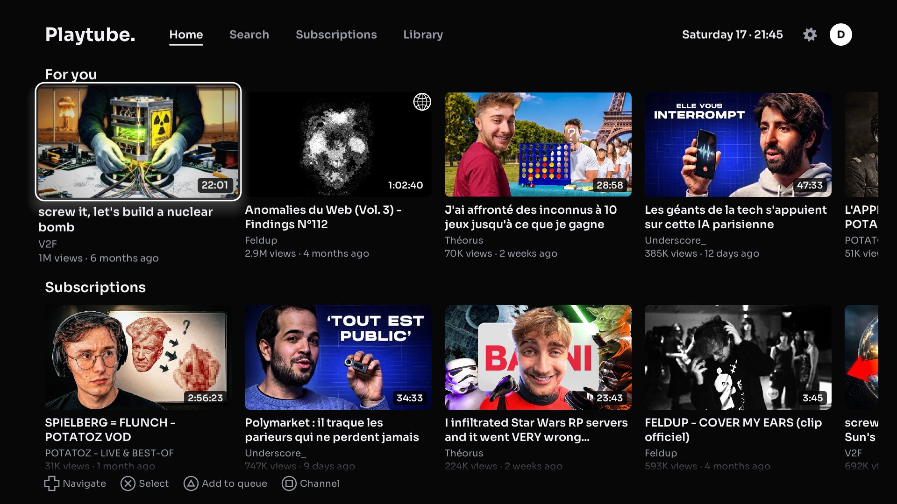
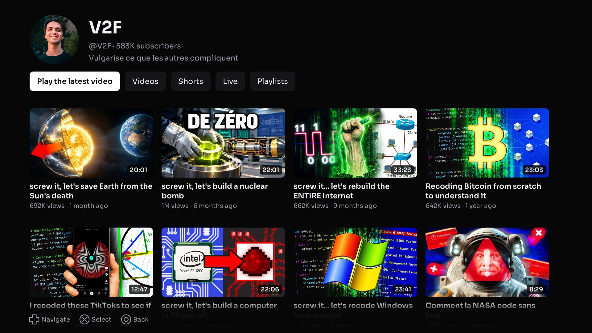
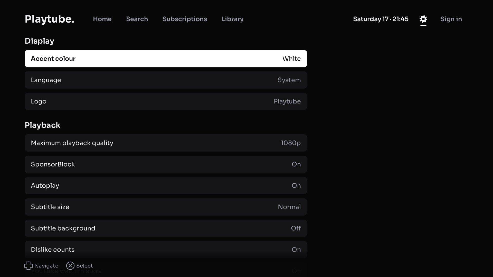

<h1 align="center">
  <picture>
    <source media="(prefers-color-scheme: dark)" srcset="images/logo-on-dark.png">
    
  </picture>
</h1>

A YouTube client for the PlayStation 4, for consoles running homebrew (GoldHEN). 
No ads, sponsor segments skipped, your account if you want it.

  
  
  
  

  

## Features

- **No ads, no sponsors:** [SponsorBlock](https://sponsor.ajay.app) skips sponsors, self-promotion, reminders,
  intros and outros.
- **Made for the controller:** a home by topics with a row of Shorts, a smooth interface at 30 frames a second,
  its buttons always shown on screen.
- **Your TV's remote:** with HDMI-CEC, Playtube answers the TV's remote, no controller needed (turn on "Enable
  HDMI Device Link" in the PS4's settings).
- **Playback up to 1080p and live streams,** with chapters (L1 / R1 jump between them), a picture of where you
  land while seeking, the time the video ends, the volume, the picture's size and subtitles of the size you like.
- **Shorts** played upright, ↑ / ↓ to the next one.
- **Picks up where you left off:** a red bar under the videos you started, a queue (△ on any video) played before
  the next suggestion.
- **Your account, if you want it:** sign in with a code on your phone for your recommendations, subscriptions,
  history, watch later and playlists; like, subscribe, save; what you watch goes into your YouTube history (a
  setting turns it off).
- **Live chat** beside a live stream, and **comments** beside a video, with dislike counts from
  [Return YouTube Dislike](https://returnyoutubedislike.com).
- **Shorts only when you want them:** a setting hides them everywhere but in search.
- **[DeArrow](https://dearrow.ajay.app):** an option (off by default) that replaces the (often clickbait) thumbnails
  and titles with the ones its community chose.
- **For the whole household:** one profile per PS4 account, 14 languages, an accent colour of your choice, a
  clock as the screensaver, and updates offered at the top of the settings and downloaded in one press.

## Alternatives

- The official YouTube PKG with the [yt_adskip_ps4](https://github.com/earthonion/yt_adskip_ps4) plugin by
  earthonion: a GoldHEN plugin that skips the ads and the sponsored segments in YouTube's own app.

## Screenshots

Screenshots from the Linux build. The home shows the latest videos of V2F, Feldup, Théorus, Underscore_ and
POTATOZ.

Playtube is not affiliated with Google or YouTube.

## Requirements

- A PS4 with GoldHEN (the app is a homebrew package; the console's firmware and saves are not touched).

## Installing

1. Download `IV0001-PLTB00000_00-PLTB000000100000.pkg` with the button at the top, copy it to the console (USB
   drive or FTP) and install it from GoldHEN → Debug Settings → Package Installer.
2. Start Playtube from the home screen.

It replaces an earlier Playtube installed with the same title id (`PLTB00000`): at the first start it takes over
that version's sign-in and recent searches, and leaves its files as they are.

Before installing: back up your saves and settings, never power off the console while a package is installing,
and prefer external storage for testing builds.

The app keeps its settings in `/data/Playtube/` on the console (settings, each PS4 account's sign-in and watching
progress in `users/`, and `playtube.log`).

## Updating

From 1.0.0: Playtube shows a banner at the top of its settings when a newer version is published. Download it
there; it goes to `/data/pkg`, then install it from GoldHEN → Debug Settings → Package Installer.

## Building

Linux (development): `cmake --preset linux-debug && cmake --build --preset linux-debug`, then
`ctest --preset linux-debug` for the tests.
PS4 package: `scripts/build-ps4.sh` (Docker, with the OpenOrbis toolchain and the PS4 libraries of the
`deps` release).

## Licence and source

Playtube is free software under the GNU General Public License v3.0 (see [LICENSE](LICENSE)). It is built with
third-party components under their own licences, listed in [THIRD_PARTY_LICENSES](THIRD_PARTY_LICENSES).
